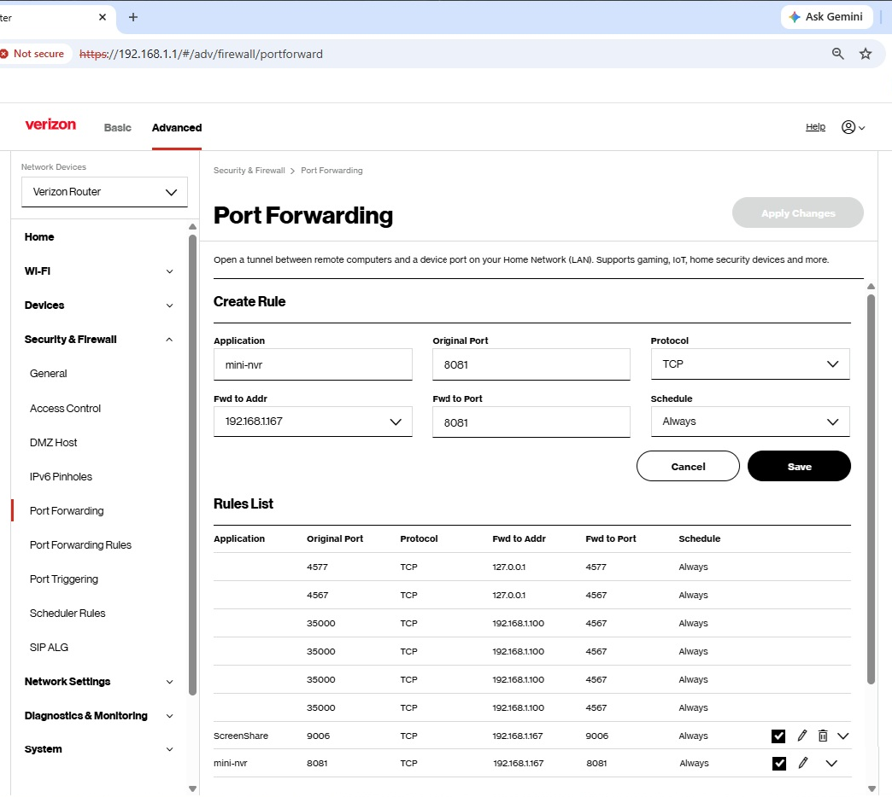

# Mini-NVR

**A simple, lightweight home video surveillance system**

## Quick Setting Up and Start

### Installations

#### 1\. Download and Install Node.js

Go to the [official Node.js website](<https://nodejs.org/en/download>) to download and install it.

#### 2\. Download and Unzip Mini-NVR

Download the zip file from this GitHub and unzip it into a folder, for example, c:\mini-nvr

### Start Mini-NVR

#### 1\. Preparing (Run Once)

Open a command prompt, change to the `mini-nvr/utility` folder, and execute:

```bat
C:\mini-nvr\utility> preparing.bat
```

#### 2\. Start Mini-NVR Server

Change back to c:\mini-nvr, and execute:

```bat
C:\mini-nvr> start.bat
```

### 3\. Logon to mini-nvr web app:
When Chrome is open up the login page, enter 'admin' and 'admin!23' to logon.

---

## Table of Contents

- [Overview](#overview)
- [Features](#features)
- [Main Components](#main-components)
- [Installations](#installations)
- [Start Mini-NVR](#start-mini-nvr)
- [Server Settings](#server-settings)
- [Running StreamPump on Another Computer](#Running-StreamPump-Service-on-Another-Computer)
- [Internet Access](#make-mini-nvr-accessible-over-the-internet)
- [License and Disclaimer](#License-and-Disclaimer)

---

## Overview

**Mini-NVR** is a simple, lightweight video surveillance app designed to be easy to set up and use while providing essential home security features.

You can run it on an ordinary Windows laptop or desktop computer and use its built-in webcam, a USB camera, or IP cameras that support RTSP as your surveillance cameras.

You can make Mini-NVR accessible over the internet by setting up a portforwarding on your home WiFi router, allowing you to monitor your home anytime, from anywhere with a browser.

These essential surveillance and monitoring capabilities may meet your needs without the additional cost of a dedicated NVR system or subscription fees.

**Most importantly, Mini-NVR puts you in control of your data and privacy.** Your recordings, snapshots, and other surveillance data are stored on your own computer rather than in a third-party cloud service, giving you greater control over who can access them.


## Features

### Continuous Recording

The system captures live video streams from each registered camera and stores them locally in the `./srvr_recordings` folder on the server computer.

You can configure the days to retain recordings.

### Live View

View connected cameras live using an internet browser. You can have multiple simultaneous live views.

You can resize and move live-view dialogs around the view port using your mouse or finger.

### Motion and Object Detection

Uses AI to detect motion objects and identify people or vehicles loitering around your property.

### Storing Alert Footage

Stores alert footage clips in the following directory:

text

```text
.\public\footage_reviewer\motion_footages\[cameraId]\[yyyy-mm-dd]
```

You can configure the days to retain alert footage clips.

### Footage Review

View recorded event footage clips from the **Event Footage Review** tab.

Search and slideshow features make reviewing footage more convenient and efficient.

You can also easily review alert clips using other Windows tools such as VLC and Media Player.

### Playback Recordings

If you want to examine the context of an event in greater detail, the recording playback feature provides that capability.

Search, chronological recording lists, and slideshow features make it easy to locate relevant recordings.

You can also use Windows File Explorer and VLC/Media Player to play back recordings.

### Email Notifications

Configure Mini-NVR to send email notifications to specified recipients whenever an alert occurs.

The corresponding footage clip can be attached to the email.

### Web Recorder

Although this feature is not related to NVR functionality, you can use it to record anything with your smartphone.

Recordings are saved immediately on your Mini-NVR server.

### Security and Safeguards

Mini-NVR uses login credentials and JWT-based authentication to help protect access to the system and your video data.

Sensitive data is never stored on the client side in the browser.

When accessing Mini-NVR remotely, users must use your home router's public IP address and the custom port configured for port forwarding. This provides an additional layer of access restriction.

---

## Main Components

### Mini-NVR Server

Mini-NVR is essentially an HTTP(S) and WebSocket server designed to:

- Receive video streams from registered cameras.
- Record incoming video streams.
- Broadcast video to connected WebSocket clients upon request from the live-view page.
- Detect and identify moving objects.
- Generate and store alert footage clips.
- Provide live viewing, footage review, and recorded video playback.

### Stream Pump

Stream Pump is a component application designed to run on the same network as your video cameras.

Its responsibility is to respond to live-view requests by streaming video from the requested camera to the Mini-NVR server.

---

## Installations

### 1\. Download and Install Node.js

Mini-NVR is a Node.js application and requires Node.js to be installed on your computer.

Visit the [official Node.js website](<https://nodejs.org/en/download>) to download and install it.

Make sure `node.exe` can be executed from a command prompt at any directory.

If it cannot, add the Node.js installation folder to your system environment `PATH`.

### 2\. Download and Unzip Mini-NVR

Download Mini-NVR from its GitHub repository and unzip it into a folder, for example:

```text
C:\mini-nvr
```

The downloaded package contains all the necessary components to run Mini-NVR.

---

## Start Mini-NVR

### 1\. Preparing (Run Once)

Open a command prompt, change to the `mini-nvr/utility` folder, and execute:

```bat
C:\mini-nvr\utility> preparing.bat
```

You only need to run this utility once. There is no need to execute it every time you start Mini-NVR.

The utility performs two tasks:

1. **Generates and installs TLS certificates**Generates a self-signed TLS root CA certificate (`rootCA.pem`), together with the required private key and certificate files, in the `./sslcert` folder.
2. **Detects locally connected video cameras**Detects video devices connected to the current computer, including built-in and USB-connected cameras.
   If cameras are detected, the utility adds corresponding entries to the `SITE_CAMERAS` list in `server_setting.js`.
   Each automatically registered camera receives:
   If additional cameras are found, an incremental index is appended to their camera IDs and labels.
   - Camera ID: `my_web_camera`
   - Label: `My Web Camera`

### 2\. Start Mini-NVR Server

Open a command prompt, change to the Mini-NVR installation folder, and execute:

```bat
C:\mini-nvr> start.bat
```

This automatically launches:

- The StreamPump service.
- Chrome, opening the `login.html` page.

On the login page, enter the following default credentials:

| Field | Value |
| --- | --- |
| Username | `admin` |
| Password | `admin!23` |

Click the **Login** button to access the main page.

**Important:** Change the default administrator password as soon as possible. Refer to the Server Settings section.

### 3\. Stop Mini-NVR Server

On the Mini-NVR output console, press `Ctrl+C` to stop the server.

You may need to press it several times.

**Note:** Stop and restart the Mini-NVR server whenever `server_settings.js` is modified.

---

## Server Settings: server\_settings.js

### Change the Admin User's Password

Use Notepad or Notepad++ to open `server_settings.js`.

Locate the following code segment and change the administrator's password from `admin!23` to something else, for example, `password!23`.

```javascript
const USERACCOUNTS = {
    admin: {
        password: 'password!23',
        roles: ['administrators'],
    },
};
```

### Add a New User

You can add a new user by copying the administrator entry and changing the username, password, and roles.

For example:

```javascript
const USERACCOUNTS = {
    admin: {
        password: 'admin!23',
        roles: ['administrators'],
    },
    user1: {
        password: 'user1pwd!23',
        roles: ['viewers'],
    },
};
```

The new user `user1` has the `viewers` role.

### Manually Add a Camera

Built-in webcams and USB-connected cameras on the Mini-NVR server are registered automatically.

However, IP cameras and built-in cameras connected to other computers must be registered manually before they can join the system.

IP cameras supporting RTSP and night vision are particularly suitable for surveillance during both daytime and nighttime.

Here, we focus on adding an IP camera to the system.

You can register a new IP camera by modifying an existing entry or adding a new entry to the `SITE_CAMERAS` array in `server_settings.js`.

#### Example Camera Configuration

```javascript
{
    "siteid": "my_home",
    "cameraid": "front_door_cam",
    "label": "Front Door Camera",
    "videodevice": "",
    "audiodevice": "",
    "streamsource": "rtsp",
    "cameraip": "",
    "rtsp": "rtsp://[user]:[password]@[camera ip]:554/stream0",
    "rtspport": "",
    "rtspuser": "",
    "rtsppwd": "",
    "fps": 25,
    "width": 1280,
    "height": 720,
    "b_v": "2M",
    "audio": false,
    "audioformat": "mp2",
    "nostats": "-nostats",
    "player": "jsmpeg",
    "enabled": true
},
```

Pay particular attention to these two attributes:

| Attribute | Description |
| --- | --- |
| `streamsource` | Set to `rtsp` to indicate an RTSP video source. |
| `rtsp` | Set to the complete RTSP URL of the IP camera. |

#### Finding the IP Camera Address

For an IP camera supporting ONVIF/RTSP, connect it to your local network and determine the IP address assigned to it.

One way to find its IP address is to download and install [ODM (ONVIF Device Manager)](<https://sourceforge.net/projects/onvifdm/>).

After launching ODM, it will automatically display the IP address of the newly connected IP camera.

#### Determining the RTSP URL

There are several ways to determine the camera's RTSP URL:

1. Try the ONVIF RTSP format:text
   ```text
   rtsp://[ip address]:554/stream0
   ```
2. Check the camera's user manual.
3. Check the camera's configuration page, typically accessible at:text
   ```text
   http://[camera ip]
   ```

You can download [VLC Player](<https://www.videolan.org/vlc/>) to verify that the RTSP URL is valid and that the camera stream can be played.

---

## Running StreamPump Service on Another Computer

The StreamPump service needs to know the HTTPS URL of your Mini-NVR server in order to communicate with it.

If you want to connect cameras from another computer to your Mini-NVR surveillance system, you may need to run a StreamPump service on that computer.

You must configure StreamPump with:

- The IP address and port of the Mini-NVR server.
- A valid Mini-NVR username.
- The corresponding user's password.
- The site ID assigned to the camera.

Use Notepad to open the `start_streampump.bat` file and update the Mini-NVR server URL and the required parameters.

Example:

```bat
REM node ./streampump.min.js [mini-nvr server and port] [user] [pwd] [siteid]

node ./streampump.min.js "https://192.168.1.167:8081" "[mini-nvr user]" "[the user password]" "[site-2]"
```

Replace the example values with your actual Mini-NVR server address, credentials, and site ID.

---

## Make Mini-NVR Accessible Over the Internet

By default, your Mini-NVR service is not accessible from the internet.

To enable remote access, you need to configure port forwarding on your home Wi-Fi router.

### 1\. Configure Port Forwarding

The following screenshot shows an example of port-forwarding settings on a Verizon Wi-Fi router.



To access your router's configuration page:

1. Open a web browser on a computer connected to your home network.
2. Enter the following address in the browser's address bar:text
   ```text
   http://192.168.1.1
   ```
3. Log in using your router's administrator password.This password is often printed on a label on the back or bottom of the router.

Pay particular attention to the **Fwd to Addr** field.

It should contain the local IP address of the computer running your Mini-NVR server.

### 2\. Find Your Public IP Address

Next, find your home's public IP address, which is the internet-facing IP address assigned to your router.

You can find it by visiting:

[What Is My IP Address](<https://whatismyipaddress.com/>)

### 3\. Access Mini-NVR Remotely

Once port forwarding is configured, you should be able to access Mini-NVR remotely by entering your home's public IP address and the appropriate port number in the web browser on your iPhone, iPad, or Android device.

Use the following URL format:

```text
https://[your-public-IP-address]:[port-number]
```

Bookmark the page on your mobile device so you can easily access Mini-NVR in the future.

---

## License and Disclaimer

Mini-NVR is software provided free of charge and **"as is," without warranties of any kind.**

Motion detection, AI-based object identification, video recording, and event notifications may be inaccurate, incomplete, or fail.

No detection or recording is guaranteed.

Do not rely on Mini-NVR as your sole means of security or safety monitoring.

**Use the software at your own risk.**

See the LICENSE file for the applicable warranty disclaimer and limitation of liability.

---

## Support

**Mini-NVR** surveils your home using:

- Built-in webcams.
- USB cameras.
- IP cameras supporting RTSP.

Features include live viewing, footage review, AI-based object detection, and event notifications.

For support, please email:

\*\*dashanchang@hotmail.com\*\*

---

Copyright © 2026 Mini NVR, LLC. All rights reserved.